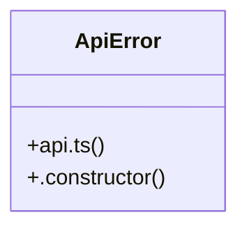

# Community 1

> 65 nodes · cohesion 0.05

## Key Concepts

- [api.ts](file:///D:/BT/To-Do/FE/src/api.ts#L1) (57 connections)
- [request()](file:///D:/BT/To-Do/FE/src/api.ts#L132) (10 connections)
- [weekToIso()](file:///D:/BT/To-Do/FE/src/utils/dates.ts#L52) (10 connections)
- [toPlaced()](file:///D:/BT/To-Do/FE/src/api.ts#L256) (5 connections)
- [toTask()](file:///D:/BT/To-Do/FE/src/api.ts#L236) (5 connections)
- [generateWeeklyReview()](file:///D:/BT/To-Do/FE/src/api.ts#L503) (4 connections)
- [getWeek()](file:///D:/BT/To-Do/FE/src/api.ts#L392) (4 connections)
- [getWeeklyReview()](file:///D:/BT/To-Do/FE/src/api.ts#L491) (4 connections)
- [saveWeeklyReview()](file:///D:/BT/To-Do/FE/src/api.ts#L519) (4 connections)
- [toHabit()](file:///D:/BT/To-Do/FE/src/api.ts#L261) (4 connections)
- [recognize()](file:///D:/BT/To-Do/FE/src/components/AIHabitRecognitionModal.tsx#L47) (3 connections)
- [createHabit()](file:///D:/BT/To-Do/FE/src/api.ts#L825) (3 connections)
- [createTask()](file:///D:/BT/To-Do/FE/src/api.ts#L550) (3 connections)
- [freqToBe()](file:///D:/BT/To-Do/FE/src/api.ts#L234) (3 connections)
- [getAiQuota()](file:///D:/BT/To-Do/FE/src/api.ts#L850) (3 connections)
- [recognizeHabits()](file:///D:/BT/To-Do/FE/src/api.ts#L878) (3 connections)
- [register()](file:///D:/BT/To-Do/FE/src/api.ts#L302) (3 connections)
- [reviewStatsToFe()](file:///D:/BT/To-Do/FE/src/api.ts#L461) (3 connections)
- [toUser()](file:///D:/BT/To-Do/FE/src/api.ts#L294) (3 connections)
- [updateHabit()](file:///D:/BT/To-Do/FE/src/api.ts#L886) (3 connections)
- [updateTask()](file:///D:/BT/To-Do/FE/src/api.ts#L585) (3 connections)
- [weeklyReviewToFe()](file:///D:/BT/To-Do/FE/src/api.ts#L480) (3 connections)
- [generate()](file:///D:/BT/To-Do/FE/src/components/WeeklyReviewModal.tsx#L58) (3 connections)
- [ApiError](file:///D:/BT/To-Do/FE/src/api.ts#L28) (2 connections)
- [createCategory()](file:///D:/BT/To-Do/FE/src/api.ts#L610) (2 connections)
- *... and 40 more nodes in this community*

## Class Diagram

## Relationships

- No strong cross-community connections detected

## Source Files

- [D:\BT\To-Do\BE\scripts\check_ai.py](file:///D:/BT/To-Do/BE/scripts/check_ai.py)
- [D:\BT\To-Do\FE\src\api.ts](file:///D:/BT/To-Do/FE/src/api.ts)
- [D:\BT\To-Do\FE\src\components\AIHabitRecognitionModal.tsx](file:///D:/BT/To-Do/FE/src/components/AIHabitRecognitionModal.tsx)
- [D:\BT\To-Do\FE\src\components\WeeklyReviewModal.tsx](file:///D:/BT/To-Do/FE/src/components/WeeklyReviewModal.tsx)
- [D:\BT\To-Do\FE\src\pages\Register.tsx](file:///D:/BT/To-Do/FE/src/pages/Register.tsx)
- [D:\BT\To-Do\FE\src\utils\dates.ts](file:///D:/BT/To-Do/FE/src/utils/dates.ts)

## Audit Trail

- EXTRACTED: 173 (84%)
- INFERRED: 32 (16%)
- AMBIGUOUS: 0 (0%)

---

*Part of the graphify knowledge wiki. See [[index]] to navigate.*