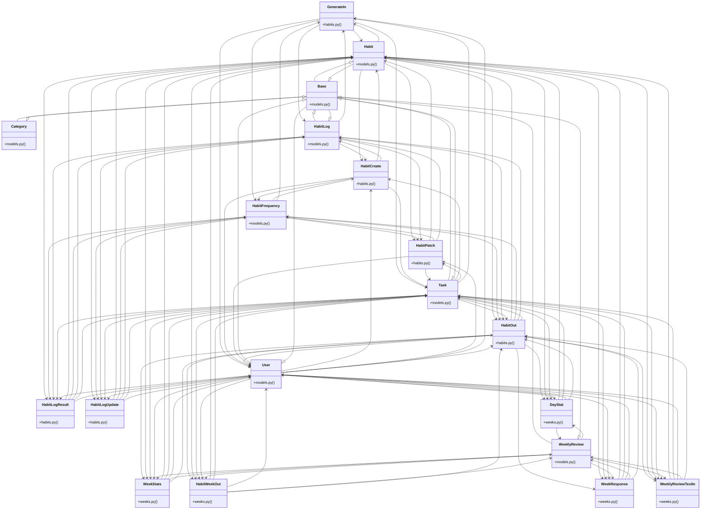

# Community 2

> 60 nodes · cohesion 0.13

## Key Concepts

- [Task](file:///D:/BT/To-Do/BE/src/models.py#L77) (45 connections)
- [Habit](file:///D:/BT/To-Do/BE/src/models.py#L150) (43 connections)
- [HabitFrequency](file:///D:/BT/To-Do/BE/src/models.py#L21) (40 connections)
- [User](file:///D:/BT/To-Do/BE/src/models.py#L33) (35 connections)
- [HabitLog](file:///D:/BT/To-Do/BE/src/models.py#L191) (34 connections)
- [habits.py](file:///D:/BT/To-Do/BE/src/routers/habits.py#L1) (14 connections)
- [HabitOut](file:///D:/BT/To-Do/BE/src/routers/habits.py#L50) (13 connections)
- [WeeklyReview](file:///D:/BT/To-Do/BE/src/models.py#L207) (13 connections)
- [models.py](file:///D:/BT/To-Do/BE/src/models.py#L1) (11 connections)
- [Category](file:///D:/BT/To-Do/BE/src/models.py#L58) (10 connections)
- [Seed data for FocusFlow AI. Tạo dữ liệu mẫu: - Khoảng 1 năm công việc (tasks) ph](file:///D:/BT/To-Do/BE/src/seed.py#L1) (10 connections)
- [seed_user_data()](file:///D:/BT/To-Do/BE/src/seed.py#L279) (10 connections)
- [Tạo dữ liệu mẫu 1 năm cho một user.](file:///D:/BT/To-Do/BE/src/seed.py#L280) (9 connections)
- [Hàm chính thực hiện nạp dữ liệu mẫu.](file:///D:/BT/To-Do/BE/src/seed.py#L536) (9 connections)
- **str** (9 connections)
- [DayStat](file:///D:/BT/To-Do/BE/src/routers/weeks.py#L23) (9 connections)
- [HabitWeekOut](file:///D:/BT/To-Do/BE/src/routers/weeks.py#L37) (9 connections)
- [WeekResponse](file:///D:/BT/To-Do/BE/src/routers/weeks.py#L45) (9 connections)
- [WeekStats](file:///D:/BT/To-Do/BE/src/routers/weeks.py#L31) (9 connections)
- [Base](file:///D:/BT/To-Do/BE/src/models.py#L17) (8 connections)
- [seed_database()](file:///D:/BT/To-Do/BE/src/seed.py#L535) (8 connections)
- [WeeklyReviewTextIn](file:///D:/BT/To-Do/BE/src/routers/weeks.py#L57) (8 connections)
- [GenerateIn](file:///D:/BT/To-Do/BE/src/routers/habits.py#L60) (7 connections)
- [HabitCreate](file:///D:/BT/To-Do/BE/src/routers/habits.py#L32) (7 connections)
- [HabitLogResult](file:///D:/BT/To-Do/BE/src/routers/habits.py#L69) (7 connections)
- *... and 35 more nodes in this community*

## Class Diagram

## Relationships

- No strong cross-community connections detected

## Source Files

- [D:\BT\To-Do\BE\scripts\seed.py](file:///D:/BT/To-Do/BE/scripts/seed.py)
- [D:\BT\To-Do\BE\src\habit_utils.py](file:///D:/BT/To-Do/BE/src/habit_utils.py)
- [D:\BT\To-Do\BE\src\models.py](file:///D:/BT/To-Do/BE/src/models.py)
- [D:\BT\To-Do\BE\src\routers\analytics.py](file:///D:/BT/To-Do/BE/src/routers/analytics.py)
- [D:\BT\To-Do\BE\src\routers\habits.py](file:///D:/BT/To-Do/BE/src/routers/habits.py)
- [D:\BT\To-Do\BE\src\routers\reminders.py](file:///D:/BT/To-Do/BE/src/routers/reminders.py)
- [D:\BT\To-Do\BE\src\routers\weeks.py](file:///D:/BT/To-Do/BE/src/routers/weeks.py)
- [D:\BT\To-Do\BE\src\seed.py](file:///D:/BT/To-Do/BE/src/seed.py)

## Audit Trail

- EXTRACTED: 134 (24%)
- INFERRED: 420 (76%)
- AMBIGUOUS: 0 (0%)

---

*Part of the graphify knowledge wiki. See [[index]] to navigate.*