# Community 3

> 54 nodes · cohesion 0.08

## Key Concepts

- **BaseModel** (40 connections)
- [TaskPriority](file:///D:/BT/To-Do/BE/src/models.py#L27) (14 connections)
- [task_schemas.py](file:///D:/BT/To-Do/BE/src/task_schemas.py#L1) (13 connections)
- [Xóa vĩnh viễn. Task do habit sinh chỉ đánh dấu purged_at để không bị sinh lại.](file:///D:/BT/To-Do/BE/src/routers/tasks.py#L133) (12 connections)
- [US-30: Lưu hàng loạt các bước phân rã đã được người dùng chỉnh sửa và xác nhận.](file:///D:/BT/To-Do/BE/src/routers/tasks.py#L326) (12 connections)
- [Ghép subtask thành steps. Subtask hợp lệ khi cùng trạng thái xóa với task cha.](file:///D:/BT/To-Do/BE/src/routers/tasks.py#L62) (12 connections)
- [habit_schemas.py](file:///D:/BT/To-Do/BE/src/habit_schemas.py#L1) (8 connections)
- [schemas.py](file:///D:/BT/To-Do/BE/src/schemas.py#L1) (7 connections)
- [TaskOut](file:///D:/BT/To-Do/BE/src/task_schemas.py#L124) (7 connections)
- [BulkIn](file:///D:/BT/To-Do/BE/src/task_schemas.py#L118) (6 connections)
- [CountOut](file:///D:/BT/To-Do/BE/src/task_schemas.py#L155) (6 connections)
- [TaskCreate](file:///D:/BT/To-Do/BE/src/task_schemas.py#L48) (6 connections)
- [TaskListOut](file:///D:/BT/To-Do/BE/src/task_schemas.py#L150) (6 connections)
- [TaskPatch](file:///D:/BT/To-Do/BE/src/task_schemas.py#L72) (6 connections)
- [TrashItemOut](file:///D:/BT/To-Do/BE/src/task_schemas.py#L146) (6 connections)
- [reminder_schemas.py](file:///D:/BT/To-Do/BE/src/reminder_schemas.py#L1) (5 connections)
- [_clean()](file:///D:/BT/To-Do/BE/src/task_schemas.py#L62) (5 connections)
- [HeatmapOut](file:///D:/BT/To-Do/BE/src/analytics_schemas.py#L27) (4 connections)
- [put_settings()](file:///D:/BT/To-Do/BE/src/routers/me.py#L26) (4 connections)
- [Chỉ cập nhật các trường được gửi lên.](file:///D:/BT/To-Do/BE/src/routers/me.py#L31) (4 connections)
- [clean_time()](file:///D:/BT/To-Do/BE/src/task_schemas.py#L37) (4 connections)
- [HeatmapHabit](file:///D:/BT/To-Do/BE/src/analytics_schemas.py#L9) (3 connections)
- [category_schemas.py](file:///D:/BT/To-Do/BE/src/category_schemas.py#L1) (3 connections)
- [me.py](file:///D:/BT/To-Do/BE/src/routers/me.py#L1) (3 connections)
- [_clean()](file:///D:/BT/To-Do/BE/src/habit_schemas.py#L19) (3 connections)
- *... and 29 more nodes in this community*

## Class Diagram

```mermaid
classDiagram
    class HeatmapHabit {
        +analytics_schemas.py()
    }
    class HeatmapOut {
        +analytics_schemas.py()
    }
    class CategoryCreate {
        +category_schemas.py()
    }
    class CategoryOut {
        +category_schemas.py()
    }
    class HabitCreate {
        +habit_schemas.py()
    }
    class HabitGenerateIn {
        +habit_schemas.py()
    }
    class HabitLogUpdate {
        +habit_schemas.py()
    }
    class HabitOut {
        +habit_schemas.py()
    }
    class HabitPatch {
        +habit_schemas.py()
    }
    class HabitWeekItem {
        +habit_schemas.py()
    }
    class WeekDataOut {
        +habit_schemas.py()
    }
    class TaskPriority {
        +models.py()
    }
    class RemindersOut {
        +reminder_schemas.py()
    }
    class SettingsOut {
        +reminder_schemas.py()
    }
    class SettingsPatch {
        +reminder_schemas.py()
    }
    class UpcomingTask {
        +reminder_schemas.py()
    }
    class LoginIn {
        +schemas.py()
    }
    class RegisterIn {
        +schemas.py()
    }
    class TokenOut {
        +schemas.py()
    }
    class UserOut {
        +schemas.py()
    }
    class BulkIn {
        +task_schemas.py()
    }
    class BulkItem {
        +task_schemas.py()
    }
    class CountOut {
        +task_schemas.py()
    }
    class TaskCreate {
        +task_schemas.py()
    }
    class TaskListOut {
        +task_schemas.py()
    }
    class TaskOut {
        +task_schemas.py()
    }
    class TaskPatch {
        +task_schemas.py()
    }
    class TrashItemOut {
        +task_schemas.py()
    }
    TaskPriority --> TaskCreate
    TaskPriority --> TaskPatch
    TaskPriority --> BulkItem
    TaskPriority --> BulkIn
    TaskPriority --> TaskOut
    TaskPriority --> TrashItemOut
    TaskPriority --> TaskListOut
    TaskPriority --> CountOut
    BulkIn --> TaskPriority
    BulkItem --> TaskPriority
    CountOut --> TaskPriority
    TaskCreate --> TaskPriority
    TaskListOut --> TaskPriority
    TrashItemOut <|-- TaskOut
    TaskOut --> TaskPriority
    TaskPatch --> TaskPriority
    TaskOut <|-- TrashItemOut
    TrashItemOut --> TaskPriority
```

## Relationships

- No strong cross-community connections detected

## Source Files

- [D:\BT\To-Do\BE\src\analytics_schemas.py](file:///D:/BT/To-Do/BE/src/analytics_schemas.py)
- [D:\BT\To-Do\BE\src\category_schemas.py](file:///D:/BT/To-Do/BE/src/category_schemas.py)
- [D:\BT\To-Do\BE\src\habit_schemas.py](file:///D:/BT/To-Do/BE/src/habit_schemas.py)
- [D:\BT\To-Do\BE\src\models.py](file:///D:/BT/To-Do/BE/src/models.py)
- [D:\BT\To-Do\BE\src\reminder_schemas.py](file:///D:/BT/To-Do/BE/src/reminder_schemas.py)
- [D:\BT\To-Do\BE\src\routers\me.py](file:///D:/BT/To-Do/BE/src/routers/me.py)
- [D:\BT\To-Do\BE\src\routers\tasks.py](file:///D:/BT/To-Do/BE/src/routers/tasks.py)
- [D:\BT\To-Do\BE\src\schemas.py](file:///D:/BT/To-Do/BE/src/schemas.py)
- [D:\BT\To-Do\BE\src\task_schemas.py](file:///D:/BT/To-Do/BE/src/task_schemas.py)

## Audit Trail

- EXTRACTED: 170 (64%)
- INFERRED: 97 (36%)
- AMBIGUOUS: 0 (0%)

---

*Part of the graphify knowledge wiki. See [[index]] to navigate.*