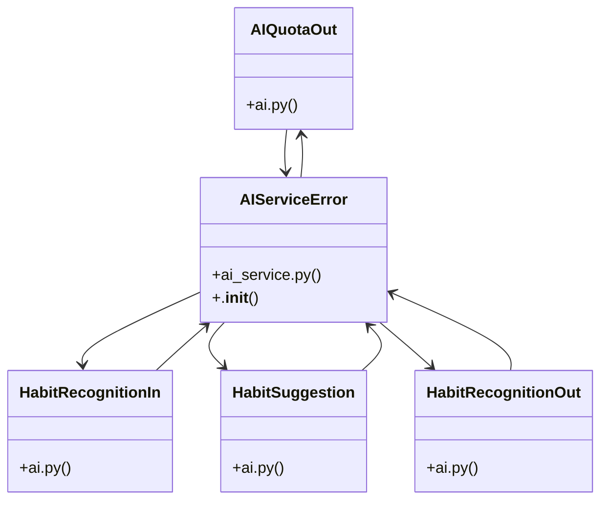

# Community 6

> 32 nodes · cohesion 0.10

## Key Concepts

- [AIServiceError](file:///D:/BT/To-Do/BE/src/ai_service.py#L14) (17 connections)
- [ai.py](file:///D:/BT/To-Do/BE/src/routers/ai.py#L1) (10 connections)
- [ai_service.py](file:///D:/BT/To-Do/BE/src/ai_service.py#L1) (6 connections)
- [get_ai_quota_status()](file:///D:/BT/To-Do/BE/src/routers/ai.py#L25) (5 connections)
- [generate_json()](file:///D:/BT/To-Do/BE/src/ai_service.py#L182) (5 connections)
- [get_ai_quota()](file:///D:/BT/To-Do/BE/src/ai_service.py#L38) (5 connections)
- [_reserve_request()](file:///D:/BT/To-Do/BE/src/ai_service.py#L87) (5 connections)
- [test_us38_ai_quota.py](file:///D:/BT/To-Do/BE/tests/test_us38_ai_quota.py#L1) (5 connections)
- [AIQuotaOut](file:///D:/BT/To-Do/BE/src/routers/ai.py#L15) (4 connections)
- [HabitRecognitionIn](file:///D:/BT/To-Do/BE/src/routers/ai.py#L30) (4 connections)
- [HabitRecognitionOut](file:///D:/BT/To-Do/BE/src/routers/ai.py#L74) (4 connections)
- [HabitSuggestion](file:///D:/BT/To-Do/BE/src/routers/ai.py#L42) (4 connections)
- [_request_json()](file:///D:/BT/To-Do/BE/src/ai_service.py#L119) (4 connections)
- [reset_ai_usage()](file:///D:/BT/To-Do/BE/tests/test_us38_ai_quota.py#L19) (4 connections)
- [test_ai_quota_rate_limit_exceeded()](file:///D:/BT/To-Do/BE/tests/test_us38_ai_quota.py#L35) (4 connections)
- [Kiểm tra hạn mức gọi AI của người dùng (US-38).](file:///D:/BT/To-Do/BE/src/routers/ai.py#L26) (3 connections)
- [recognize_habits()](file:///D:/BT/To-Do/BE/src/routers/ai.py#L81) (3 connections)
- [_settings()](file:///D:/BT/To-Do/BE/src/ai_service.py#L62) (3 connections)
- [test_us38_api_endpoints.py](file:///D:/BT/To-Do/BE/tests/test_us38_api_endpoints.py#L1) (3 connections)
- [test_ai_quota_initial_state()](file:///D:/BT/To-Do/BE/tests/test_us38_ai_quota.py#L24) (3 connections)
- [test_ai_quota_window_expiration()](file:///D:/BT/To-Do/BE/tests/test_us38_ai_quota.py#L62) (3 connections)
- [test_upstream_provider_quota_429()](file:///D:/BT/To-Do/BE/tests/test_us38_ai_quota.py#L77) (2 connections)
- [test_get_ai_quota_status_endpoint()](file:///D:/BT/To-Do/BE/tests/test_us38_api_endpoints.py#L12) (2 connections)
- [test_get_ai_quota_status_with_existing_usage()](file:///D:/BT/To-Do/BE/tests/test_us38_api_endpoints.py#L24) (2 connections)
- [require_custom_days()](file:///D:/BT/To-Do/BE/src/routers/ai.py#L66) (1 connections)
- *... and 7 more nodes in this community*

## Class Diagram

## Relationships

- No strong cross-community connections detected

## Source Files

- [D:\BT\To-Do\BE\src\ai_service.py](file:///D:/BT/To-Do/BE/src/ai_service.py)
- [D:\BT\To-Do\BE\src\routers\ai.py](file:///D:/BT/To-Do/BE/src/routers/ai.py)
- [D:\BT\To-Do\BE\tests\test_us38_ai_quota.py](file:///D:/BT/To-Do/BE/tests/test_us38_ai_quota.py)
- [D:\BT\To-Do\BE\tests\test_us38_api_endpoints.py](file:///D:/BT/To-Do/BE/tests/test_us38_api_endpoints.py)

## Audit Trail

- EXTRACTED: 76 (64%)
- INFERRED: 42 (36%)
- AMBIGUOUS: 0 (0%)

---

*Part of the graphify knowledge wiki. See [[index]] to navigate.*