# WeeklyReview

> God node · 13 connections · [D:\BT\To-Do\BE\src\models.py](file:///D:/BT/To-Do/BE/src/models.py#L207)

## Call Trace Diagram

```mermaid
sequenceDiagram
    participant P0 as WeeklyReview
    participant P1 as Seed data for FocusFlow AI. Tạo dữ liệu mẫu: - Khoảng 1 năm công việc (tasks) ph
    participant P2 as Task
    participant P3 as HabitOut
    participant P4 as Ghép subtask thành steps. Subtask hợp lệ khi cùng trạng thái xóa với task cha.
    participant P5 as Xóa vĩnh viễn. Task do habit sinh chỉ đánh dấu purged_at để không bị sinh lại.
    participant P6 as US-30: Lưu hàng loạt các bước phân rã đã được người dùng chỉnh sửa và xác nhận.
    participant P7 as seed_user_data()
    participant P8 as update_task()
    participant P9 as Tạo dữ liệu mẫu 1 năm cho một user.
    participant P10 as Hàm chính thực hiện nạp dữ liệu mẫu.
    participant P11 as DayStat
    participant P12 as WeekStats
    participant P13 as HabitWeekOut
    participant P14 as WeekResponse
    participant P15 as WeeklyReviewTextIn
    participant P16 as HabitCreate
    participant P17 as HabitPatch
    participant P18 as GenerateIn
    participant P19 as HabitLogUpdate
    participant P20 as HabitLogResult
    participant P21 as Lấy dữ liệu toàn bộ của một tuần ISO: tasks, thống kê 7 ngày, thống kê tuần, hab
    participant P22 as Lấy danh sách các habit chưa bị xóa (bao gồm cả tạm dừng).
    participant P23 as Cập nhật habit và xử lý task tương lai theo quy tắc dọn dẹp đã chốt.
    participant P24 as Xóa mềm habit: deleted_at = utc_now(), is_active = False. Dọn task tương lai chư
    participant P25 as Sinh task còn thiếu cho một tuần ISO.
    participant P26 as Đánh dấu log hoàn thành của habit cho ngày hôm nay. Đồng bộ sang task cùng ngày
    participant P27 as Dữ liệu cho Electron quyết định có hiện toast không. Chỉ đọc.     BE chỉ cung cấ
    participant P28 as generate_habit_tasks()
    participant P29 as create_task()
    participant P30 as Tiện ích dùng chung cho habit: tính lịch, sinh task, dọn task khi đổi lịch.
    participant P31 as Làm tròn đến số nguyên gần nhất (0.5 làm tròn lên).
    participant P32 as Trả về set các weekday (0=Mon..6=Sun) mà habit có lịch.
    participant P33 as Trả về danh sách weekday sắp xếp tăng dần, dùng cho API response.
    participant P34 as Chuẩn hóa days: kiểm tra 0-6, loại trùng, sắp tăng dần, trả chuỗi.
    participant P35 as Trả về custom_days đã chuẩn hóa. Khi frequency != custom thì trả None.     Khi f
    participant P36 as Sinh task còn thiếu cho các habit đang bật auto_create_task, trong một tuần ISO.
    participant P37 as Lấy task habit từ ngày mai trở đi, chưa Done và chưa bị người dùng sửa.
    participant P38 as Câu 21: Khi đổi lịch habit, xóa task tương lai không còn khớp.     Chỉ đụng task
    participant P39 as Câu 23/69: Đổi preferred_time → cập nhật giờ cho task chưa sửa.
    participant P40 as Suy ra Đợt 4: Đổi tên habit → task tương lai chưa sửa đổi tên theo.
    participant P41 as Câu 36/21: Xóa habit → xóa task tương lai chưa Done, chưa sửa.     Task hôm nay/
    participant P42 as Tạm dừng habit: chỉ ngừng sinh task mới, không xóa task đang có.     Hàm này khô
    participant P43 as Trả về dữ liệu tiến độ tuần cho một habit: scheduled (7 bool), logs (7 bool), pr
    participant P44 as bulk_create()
    participant P45 as Habit
    participant P46 as HabitFrequency
    participant P47 as User
    participant P48 as HabitLog
    participant P49 as TaskPriority
    participant P50 as Category
    participant P51 as save_weekly_review()
    P0->>+ P1: uses
    P1-->>- P0: return
    P1->>+ P2: uses
    P2-->>- P1: return
    P2->>+ P3: uses
    P3-->>- P2: return
    P2->>+ P4: uses
    P4-->>- P2: return
    P2->>+ P5: uses
    P5-->>- P2: return
    P2->>+ P6: uses
    P6-->>- P2: return
    P2->>+ P1: uses
    P1-->>- P2: return
    P2->>+ P7: calls
    P7-->>- P2: return
    P2->>+ P8: calls
    P8-->>- P2: return
    P2->>+ P9: uses
    P9-->>- P2: return
    P2->>+ P10: uses
    P10-->>- P2: return
    P2->>+ P11: uses
    P11-->>- P2: return
    P2->>+ P12: uses
    P12-->>- P2: return
    P2->>+ P13: uses
    P13-->>- P2: return
    P2->>+ P14: uses
    P14-->>- P2: return
    P2->>+ P15: uses
    P15-->>- P2: return
    P2->>+ P16: uses
    P16-->>- P2: return
    P2->>+ P17: uses
    P17-->>- P2: return
    P2->>+ P18: uses
    P18-->>- P2: return
    P2->>+ P19: uses
    P19-->>- P2: return
    P2->>+ P20: uses
    P20-->>- P2: return
    P2->>+ P21: uses
    P21-->>- P2: return
    P2->>+ P22: uses
    P22-->>- P2: return
    P2->>+ P23: uses
    P23-->>- P2: return
    P2->>+ P24: uses
    P24-->>- P2: return
    P2->>+ P25: uses
    P25-->>- P2: return
    P2->>+ P26: uses
    P26-->>- P2: return
    P2->>+ P27: uses
    P27-->>- P2: return
    P2->>+ P28: calls
    P28-->>- P2: return
    P2->>+ P29: calls
    P29-->>- P2: return
    P2->>+ P30: uses
    P30-->>- P2: return
    P2->>+ P31: uses
    P31-->>- P2: return
    P2->>+ P32: uses
    P32-->>- P2: return
    P2->>+ P33: uses
    P33-->>- P2: return
    P2->>+ P34: uses
    P34-->>- P2: return
    P2->>+ P35: uses
    P35-->>- P2: return
    P2->>+ P36: uses
    P36-->>- P2: return
    P2->>+ P37: uses
    P37-->>- P2: return
    P2->>+ P38: uses
    P38-->>- P2: return
    P2->>+ P39: uses
    P39-->>- P2: return
    P2->>+ P40: uses
    P40-->>- P2: return
    P2->>+ P41: uses
    P41-->>- P2: return
    P2->>+ P42: uses
    P42-->>- P2: return
    P2->>+ P43: uses
    P43-->>- P2: return
    P2->>+ P44: calls
    P44-->>- P2: return
    P1->>+ P45: uses
    P45-->>- P1: return
    P1->>+ P46: uses
    P46-->>- P1: return
    P1->>+ P47: uses
    P47-->>- P1: return
    P1->>+ P48: uses
    P48-->>- P1: return
    P1->>+ P49: uses
    P49-->>- P1: return
    P1->>+ P0: uses
    P0-->>- P1: return
    P1->>+ P50: uses
    P50-->>- P1: return
    P0->>+ P7: calls
    P7-->>- P0: return
    P0->>+ P9: uses
    P9-->>- P0: return
    P0->>+ P10: uses
    P10-->>- P0: return
    P0->>+ P11: uses
    P11-->>- P0: return
    P0->>+ P12: uses
    P12-->>- P0: return
    P0->>+ P13: uses
    P13-->>- P0: return
    P0->>+ P14: uses
    P14-->>- P0: return
    P0->>+ P15: uses
    P15-->>- P0: return
    P0->>+ P21: uses
    P21-->>- P0: return
    P0->>+ P51: calls
    P51-->>- P0: return
```

## Connections by Relation

### calls
- [[seed_user_data()]] `INFERRED`
- [[save_weekly_review()]] `INFERRED`

### contains
- [[models.py]] `EXTRACTED`

### inherits
- [[Base]] `EXTRACTED`

### uses
- [[Seed data for FocusFlow AI. Tạo dữ liệu mẫu: - Khoảng 1 năm công việc (tasks) ph]] `INFERRED`
- [[Tạo dữ liệu mẫu 1 năm cho một user.]] `INFERRED`
- [[Hàm chính thực hiện nạp dữ liệu mẫu.]] `INFERRED`
- [[DayStat]] `INFERRED`
- [[WeekStats]] `INFERRED`
- [[HabitWeekOut]] `INFERRED`
- [[WeekResponse]] `INFERRED`
- [[WeeklyReviewTextIn]] `INFERRED`
- [[Lấy dữ liệu toàn bộ của một tuần ISO: tasks, thống kê 7 ngày, thống kê tuần, hab]] `INFERRED`

---

*Part of the graphify knowledge wiki. See [[index]] to navigate.*