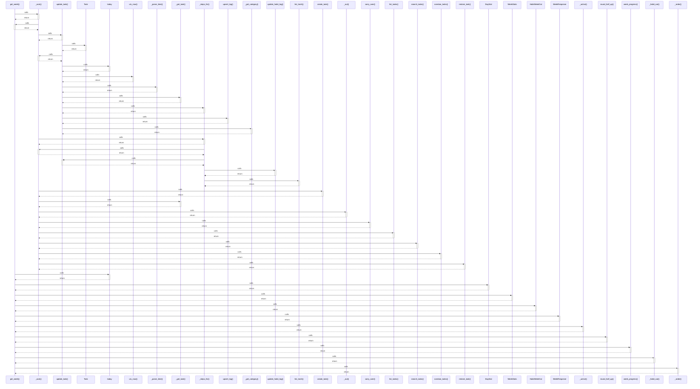

# get_week()

> God node · 13 connections · [D:\BT\To-Do\BE\src\routers\weeks.py](file:///D:/BT/To-Do/BE/src/routers/weeks.py#L72)

## Call Trace Diagram

## Connections by Relation

### calls
- [[_outs()]] `INFERRED`
- [[today]] `INFERRED`
- [[DayStat]] `EXTRACTED`
- [[WeekStats]] `EXTRACTED`
- [[HabitWeekOut]] `EXTRACTED`
- [[WeekResponse]] `EXTRACTED`
- [[_active()]] `INFERRED`
- [[round_half_up()]] `INFERRED`
- [[week_progress()]] `INFERRED`
- [[_habit_out()]] `INFERRED`
- [[_order()]] `INFERRED`

### contains
- [[weeks.py]] `EXTRACTED`

### rationale_for
- [[Lấy dữ liệu toàn bộ của một tuần ISO: tasks, thống kê 7 ngày, thống kê tuần, hab]] `EXTRACTED`

---

*Part of the graphify knowledge wiki. See [[index]] to navigate.*