# Knowledge Graph Index

> Auto-generated by graphify. Start here — read community articles for context, then drill into god nodes for detail.

**600 nodes · 1089 edges · 40 communities**

---

## System Architecture Flowchart

```mermaid
flowchart TD
    C0["Task Scheduler (120 nodes)"]
    C1["Community 1 (65 nodes)"]
    C2["Community 2 (60 nodes)"]
    C3["Community 3 (54 nodes)"]
    C4["Community 4 (36 nodes)"]
    C5["Community 5 (34 nodes)"]
    C6["Community 6 (32 nodes)"]
    C7["Community 7 (26 nodes)"]
    C8["Community 8 (23 nodes)"]
    C9["Community 9 (16 nodes)"]
    C10["Community 10 (16 nodes)"]
    C11["Community 11 (14 nodes)"]
    C12["Community 12 (9 nodes)"]
    C13["Community 13 (9 nodes)"]
    C14["Community 14 (8 nodes)"]
    C15["Community 15 (8 nodes)"]
    C16["Community 16 (7 nodes)"]
    C17["Community 17 (7 nodes)"]
    C18["Community 18 (6 nodes)"]
    C19["Community 19 (6 nodes)"]
    C20["Community 20 (4 nodes)"]
    C21["Community 21 (4 nodes)"]
    C22["Community 22 (4 nodes)"]
    C23["Community 23 (4 nodes)"]
    C24["unknown (3 nodes)"]
    C25["Community 25 (3 nodes)"]
    C26["unknown (3 nodes)"]
    C27["Community 27 (3 nodes)"]
    C28["unknown (2 nodes)"]
    C29["unknown (2 nodes)"]
    C30["Community 30 (2 nodes)"]
    C31["unknown (2 nodes)"]
    C32["unknown (1 nodes)"]
    C33["unknown (1 nodes)"]
    C34["unknown (1 nodes)"]
    C35["unknown (1 nodes)"]
    C36["unknown (1 nodes)"]
    C37["unknown (1 nodes)"]
    C38["unknown (1 nodes)"]
    C39["unknown (1 nodes)"]
    C3 -->|23 edges| C2
    C7 -->|21 edges| C2
    C2 -->|16 edges| C3
    C2 -->|14 edges| C5
    C7 -->|8 edges| C5
    C6 -->|6 edges| C2
    C2 -->|6 edges| C7
    C2 -->|6 edges| C6
    C14 -->|5 edges| C2
    C3 -->|4 edges| C6
    C5 -->|4 edges| C2
    C1 -->|4 edges| C8
    C5 -->|3 edges| C3
    C8 -->|3 edges| C1
    C7 -->|2 edges| C14
    C2 -->|2 edges| C12
    C5 -->|2 edges| C14
    C2 -->|2 edges| C11
    C2 -->|2 edges| C14
    C14 -->|2 edges| C5
    C0 -->|2 edges| C5
    C10 -->|2 edges| C1
    C12 -->|1 edges| C7
    C6 -->|1 edges| C1
    C6 -->|1 edges| C14
    C18 -->|1 edges| C2
    C18 -->|1 edges| C5
    C5 -->|1 edges| C7
    C12 -->|1 edges| C3
    C2 -->|1 edges| C25
    C3 -->|1 edges| C11
    C11 -->|1 edges| C2
    C3 -->|1 edges| C5
    C1 -->|1 edges| C15
    C9 -->|1 edges| C1
    C13 -->|1 edges| C1
```

## Communities
(sorted by size, largest first)

- [[Task Scheduler]] — 120 nodes
- [[Community 1]] — 65 nodes
- [[Community 2]] — 60 nodes
- [[Community 3]] — 54 nodes
- [[Community 4]] — 36 nodes
- [[Community 5]] — 34 nodes
- [[Community 6]] — 32 nodes
- [[Community 7]] — 26 nodes
- [[Community 8]] — 23 nodes
- [[Community 9]] — 16 nodes
- [[Community 10]] — 16 nodes
- [[Community 11]] — 14 nodes
- [[Community 12]] — 9 nodes
- [[Community 13]] — 9 nodes
- [[Community 14]] — 8 nodes
- [[Community 15]] — 8 nodes
- [[Community 16]] — 7 nodes
- [[Community 17]] — 7 nodes
- [[Community 18]] — 6 nodes
- [[Community 19]] — 6 nodes
- [[Community 20]] — 4 nodes
- [[Community 21]] — 4 nodes
- [[Community 22]] — 4 nodes
- [[Community 23]] — 4 nodes
- [[unknown]] — 3 nodes
- [[Community 25]] — 3 nodes
- [[unknown]] — 3 nodes
- [[Community 27]] — 3 nodes
- [[unknown]] — 2 nodes
- [[unknown]] — 2 nodes
- [[Community 30]] — 2 nodes
- [[unknown]] — 2 nodes
- [[unknown]] — 1 nodes
- [[unknown]] — 1 nodes
- [[unknown]] — 1 nodes
- [[unknown]] — 1 nodes
- [[unknown]] — 1 nodes
- [[unknown]] — 1 nodes
- [[unknown]] — 1 nodes
- [[unknown]] — 1 nodes

## God Nodes
(most connected concepts — the load-bearing abstractions)

- [[Task]] — 45 connections
- [[Habit]] — 43 connections
- [[HabitFrequency]] — 40 connections
- [[User]] — 35 connections
- [[HabitLog]] — 34 connections
- [[AIServiceError]] — 17 connections
- [[TaskPriority]] — 14 connections
- [[WeeklyReview]] — 13 connections
- [[HabitOut]] — 13 connections
- [[get_week()]] — 13 connections

---

*Generated by [graphify](https://github.com/safishamsi/graphify)*